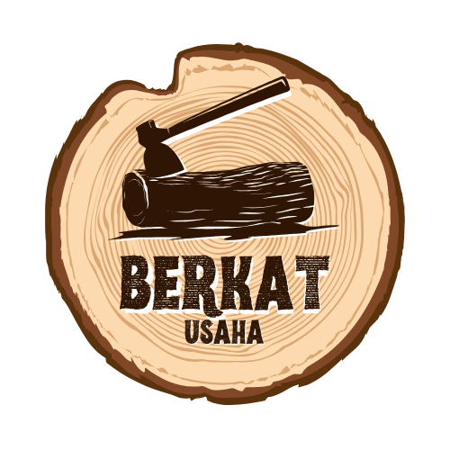

# 🪵 Berkat Usaha - Custom Furniture & Woodcraft

<div align="center">

  

  <p align="center">
    <strong>Landing page & profil usaha pengrajin kayu serta custom furniture berkualitas di Sei Guntung, Riau.</strong>
  </p>

  <p align="center">
    <a href="https://berkatusaha.rivkyps.my.id/"><strong>🌐 Kunjungi Website Live »</strong></a>
  </p>

  <p align="center">
    
    
    
    
  </p>

</div>

---

## 📌 Tentang Proyek

**Berkat Usaha** adalah website profil bisnis lokal yang berfokus pada pembuatan perabot dan custom furniture kayu solid (meja makan, kursi kerja ergonomis, lemari minimalis, kitchen set, dsb). Website ini dirancang agar cepat dimuat (*lightweight*), ramah perangkat seluler (*responsive*), dan teroptimasi penuh untuk mesin pencari (*SEO & Schema markup*).

🔗 **Live Demo**: [https://berkatusaha.rivkyps.my.id/](https://berkatusaha.rivkyps.my.id/)

---

## ✨ Fitur Utama

- **🎨 Modern & Responsive Design**: Tampilan bersih dengan nuansa warna natural kayu, dioptimalkan untuk desktop, tablet, dan smartphone.
- **📦 Interactive Product Showcase**: Katalog produk interaktif yang didukung Alpine.js dengan modal pop-up untuk melihat spesifikasi detail, jenis bahan, ukuran, dan estimasi waktu pengerjaan.
- **💬 Direct WhatsApp CTA**: Tombol pemesanan & konsultasi instan yang langsung terhubung ke WhatsApp pengrajin.
- **❓ FAQ Accordion**: Pertanyaan yang sering diajukan dengan animasi buka-tutup yang mulus menggunakan `@alpinejs/collapse`.
- **🚀 Advanced SEO & Structured Data**:
  - Open Graph & Twitter Cards untuk preview media sosial yang optimal.
  - JSON-LD Schema (`LocalBusiness`, `WebSite`, `FAQPage`) untuk meningkatkan visibilitas di Google Search.
  - Sitemap XML & Google Site Verification siap pakai.

---

## 🛠️ Tech Stack

- **Markup**: [HTML5](https://developer.mozilla.org/en-US/docs/Web/HTML) (Semantik & Accessible)
- **Styling**: [Tailwind CSS CDN](https://tailwindcss.com/) dengan palet warna kustom (*Wood tones: Primary `#6B4226`, Accent `#D4A373`, Cream `#FAF7F2`*)
- **Interactivity & State Management**: [Alpine.js](https://alpinejs.dev/) & [Alpine Collapse Plugin](https://alpinejs.dev/plugins/collapse)
- **Typography**: [Plus Jakarta Sans](https://fonts.google.com/specimen/Plus+Jakarta+Sans) via Google Fonts

---

## 📂 Struktur Direktori

```text
BerkatUsahaWood/
├── img/                       # Aset gambar & ilustrasi produk
│   ├── BERKATUSAHALOGO.png
│   ├── JumbotronImage.png
│   ├── OpenGraphImage.png
│   ├── kursikayuergonomis.jpg
│   ├── lemariminimalis.jpg
│   └── mejascandinavian.jpg
├── index.html                 # Halaman utama landing page
├── LPBERKATUSAHA.css          # Kustom styling tambahan
├── LPBERKATUSAHA.js           # Konfigurasi Tailwind & data reaktif Alpine.js
├── sitemap.xml                # Sitemap untuk perayapan search engine
├── LICENSE                    # Lisensi proyek (MIT)
└── README.md                  # Dokumentasi proyek
```

---

## 💻 Cara Menjalankan Secara Lokal

Karena proyek ini berbasis client-side murni tanpa memerlukan build step yang rumit:

### Opsi 1: Menggunakan Live Server (VS Code / Extension)
1. Buka folder proyek di editor (misal VS Code).
2. Klik kanan file `index.html` dan pilih **Open with Live Server**.

### Opsi 2: Menggunakan Python Web Server
Jalankan perintah berikut di terminal:
```bash
# Untuk Python 3
python -m http.server 8000
```
Buka browser dan akses `http://localhost:8000`.

### Opsi 3: Buka Langsung di Browser
Cukup klik dua kali (double-click) pada file `index.html`.

---

## 📍 Informasi Bisnis

- **Nama Usaha**: Berkat Usaha
- **Lokasi**: Sei Guntung, Kec. Kateman, Kab. Indragiri Hilir, Riau, Indonesia
- **Layanan**: Custom Furniture, Meja Kayu Solid, Kursi, Lemari, Kitchen Set, dsb.

---

## 📄 Lisensi

Didistribusikan di bawah lisensi **MIT**. Lihat file [`LICENSE`](LICENSE) untuk informasi lebih lanjut.